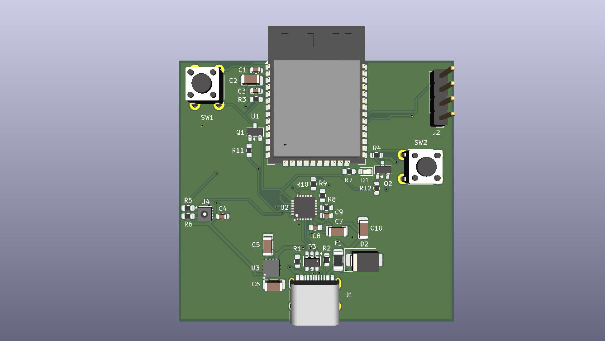
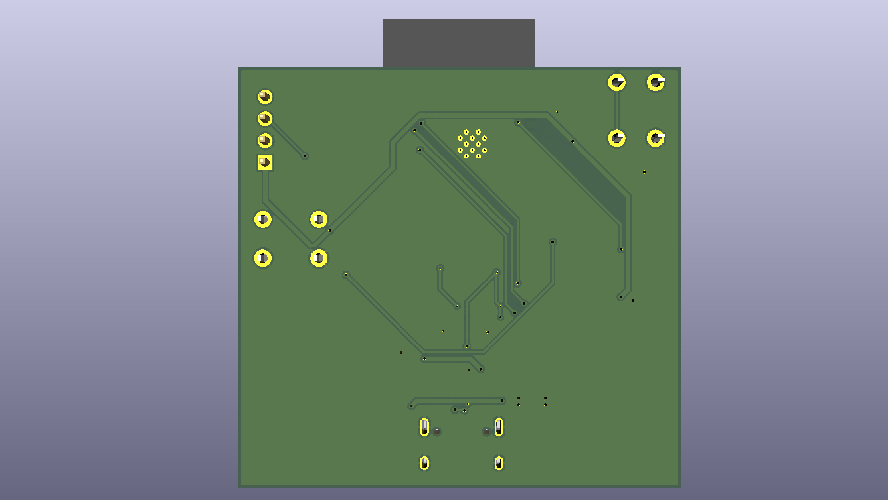
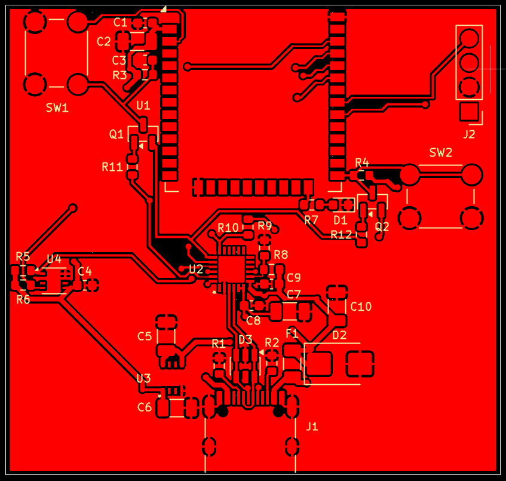
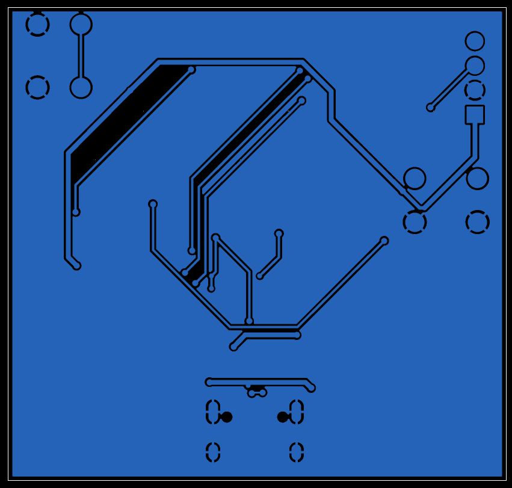
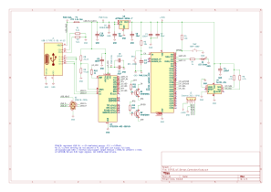

# ESP32 IoT Sensor Controller

## Project Overview

The ESP32 IoT Sensor Controller is a custom-designed,
two-layer PCB developed using KiCad 10. The project
integrates an ESP32-WROOM-32E microcontroller module,
an SHT31 temperature and humidity sensor, a CP2102N
USB-to-UART interface, and a regulated 3.3V power supply.

The project demonstrates schematic design, PCB layout,
component placement, routing, design-rule verification,
and manufacturing documentation preparation.

**Project Type:** Personal PCB Design Portfolio Project

**Design Software:** KiCad 10

**Current Status:** Design completed and manufacturing
files generated. The PCB has not yet been fabricated
or physically tested.

## Hardware Specifications

| Component | Model / Specification | Function |
|---|---|---|
| Microcontroller | ESP32-WROOM-32E | Wi-Fi and Bluetooth connectivity |
| Temperature & Humidity Sensor | SHT31 | Environmental sensing |
| USB-to-UART Converter | CP2102N | USB serial communication and programming interface |
| Voltage Regulator | AP7361C-33FGE-7 | Regulated 3.3V power supply |
| USB Connector | USB Type-C | USB power and data connection |
| PCB | 2-layer FR-4 | Custom PCB design |

## PCB 3D Views

### Top View

### Bottom View

## PCB Layout Views

### Top Copper and Silkscreen

### Bottom Copper and Silkscreen

*Layout previews captured from KiCad Gerber Viewer.
Red represents top copper; blue represents bottom copper.*

## Circuit Schematic

The complete circuit schematic was designed using KiCad 10,
featuring the ESP32-WROOM-32E, USB-to-UART interface,
3.3V power regulation, and SHT31 temperature and
humidity sensor.

[View full-resolution schematic](Images/ESP32_IoT_Sensor_Controller_Schematic.svg)
